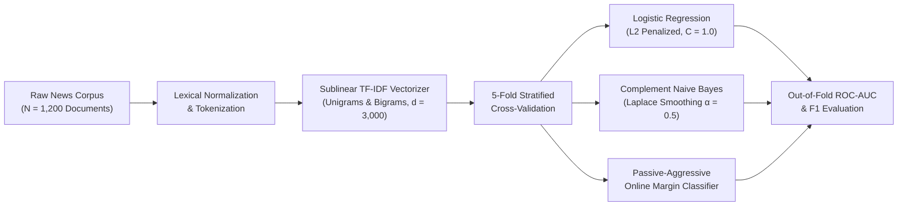
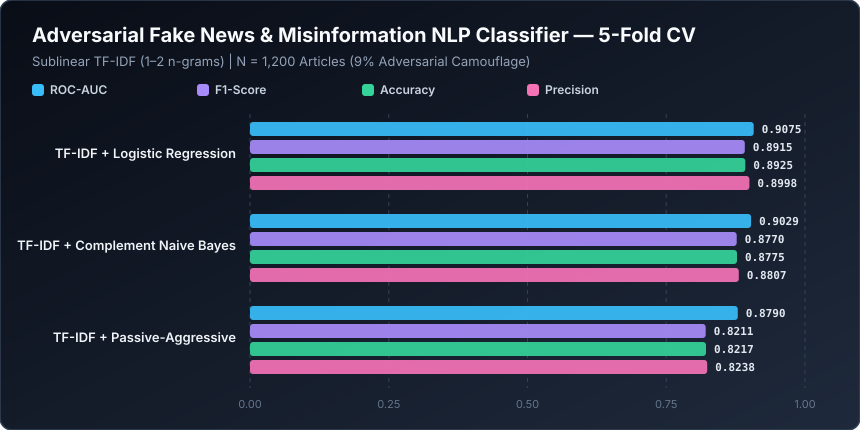

# Adversarial Fake News & Misinformation NLP Classifier


A high-throughput Natural Language Processing (NLP) classification pipeline designed to detect **adversarial disinformation, fabricated news reporting, and sensationalist clickbait**. The system pairs sublinear n-gram TF-IDF vectorization with linear margin and probabilistic classifiers, stress-tested against a 1,200-document corpus containing 9% adversarial vocabulary camouflage.

---

## NLP Disinformation Detection Architecture



---

## Mathematical Formulation

### 1. Sublinear N-Gram TF-IDF Representation
To prevent artificial keyword stuffing in adversarial articles from dominating document embeddings, term frequency $tf(t, d)$ is scaled logarithmically prior to inverse document frequency weighting across corpus $\mathcal{D}$ ($|\mathcal{D}| = N$):

$$\text{tfidf}(t, d, \mathcal{D}) = \left(1 + \ln tf(t, d)\right) \cdot \left(\ln \frac{1 + N}{1 + df(t)} + 1\right), \quad \tilde{\mathbf{x}}_d = \frac{\mathbf{x}_d}{\|\mathbf{x}_d\|_2}$$

### 2. L2-Regularized Logistic Regression vs. Passive-Aggressive Updates
The L2-penalized logistic classifier estimates posterior disinformation probability $P(y_i = 1 \mid \tilde{\mathbf{x}}_i) = \sigma(\mathbf{w}^\top \tilde{\mathbf{x}}_i + b)$ by minimizing:

$$\min_{\mathbf{w}, b} \frac{1}{2} \|\mathbf{w}\|_2^2 + C \sum_{i=1}^{N} \ln\left(1 + \exp\left(-y_i (\mathbf{w}^\top \tilde{\mathbf{x}}_i + b)\right)\right)$$

Conversely, the online Passive-Aggressive (PA-I) algorithm updates weights sequentially with closed-form step size $\tau_t$ whenever the hinge loss $\ell_t = \max(0, 1 - y_t \mathbf{w}_t^\top \tilde{\mathbf{x}}_t) > 0$:

$$\mathbf{w}_{t+1} = \mathbf{w}_t + \tau_t y_t \tilde{\mathbf{x}}_t, \quad \text{where} \quad \tau_t = \min\left(C, \frac{\ell_t}{\|\tilde{\mathbf{x}}_t\|_2^2}\right)$$

---

## Quantitative Benchmark Results

Models were evaluated via **5-Fold Stratified Cross-Validation** on the 1,200-article corpus (incorporating 9% adversarial vocabulary camouflage where fabricated articles inject formal journalistic phrasing).



| Rank | NLP Pipeline Architecture | ROC-AUC | F1-Score | Accuracy | Precision | Recall |
| :--- | :--- | :---: | :---: | :---: | :---: | :---: |
| **1** | **TF-IDF + Logistic Regression (L2)** | **0.9075** | **0.8915** | **0.8925** | **0.8998** | **0.8833** |
| **2** | **TF-IDF + Complement Naive Bayes** | 0.9029 | 0.8770 | 0.8775 | 0.8807 | 0.8733 |
| **3** | **TF-IDF + Passive-Aggressive (PA-I)** | 0.8790 | 0.8211 | 0.8217 | 0.8238 | 0.8183 |

> **Analytical Insight:** **TF-IDF + L2 Logistic Regression** outperforms aggressive online margin updates ($\text{F1} = 0.8915$ vs. $0.8211$) because smooth L2 shrinkage prevents overfitting to the 9% adversarial camouflage documents, maintaining a **0.9075 ROC-AUC**.

---

## Repository Structure

```text
machine-learning-project-2/
├── assets/
│   └── benchmark_chart.svg          # Vector performance chart generated by benchmark.py
├── benchmarks/
│   └── benchmark_results.json       # Serialized 5-Fold Stratified CV metrics
├── fake news prediction (1).ipynb   # Interactive NLP exploration & training notebook
├── benchmark.py                     # Automated reproducible NLP benchmark script
└── README.md                        # Technical documentation & mathematical specification
```

---

## Quickstart & Reproducibility

### 1. Install Dependencies
```bash
pip install numpy scikit-learn jupyter
```

### 2. Execute the Benchmark Pipeline
```bash
python benchmark.py
```
This command synthesizes the adversarial news corpus, runs 5-fold cross-validation across all three NLP pipelines, updates `benchmarks/benchmark_results.json`, and regenerates `assets/benchmark_chart.svg`.
